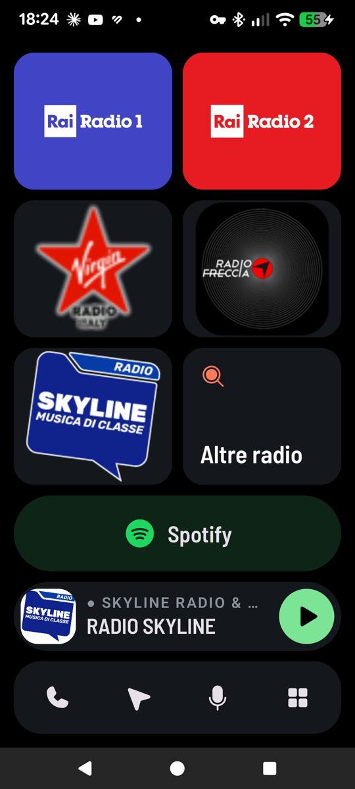
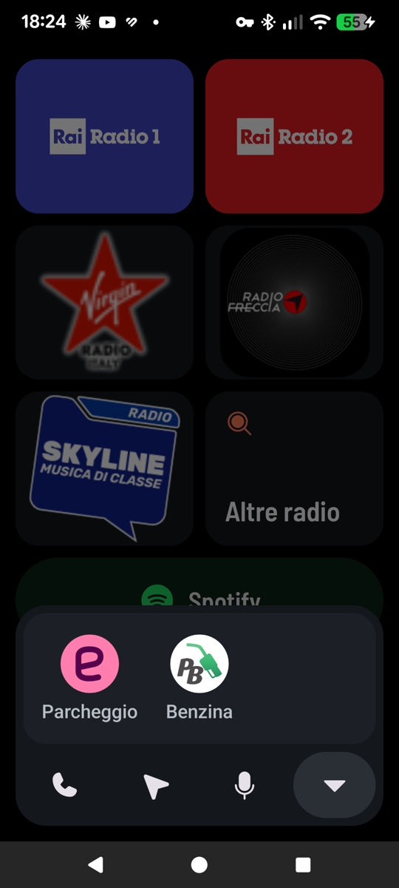

# Cockpit

A personal car launcher for Android. The phone sits on a dashboard mount and
plays through the car radio via a USB-C splitter (charging + audio). Plugging
the splitter in turns the phone into a car head unit; unplugging it turns it
back into a phone.

<p>
  
  
</p>

It is built for glancing while driving: big targets in fixed positions, a
pure black screen for night driving, and one tap for the thing you do most
(switching station).

This is not a product to install as it is: it is one person's setup, published
as a primer. Fork it and shape it around your own car, stations and apps,
ideally with a coding agent. `CLAUDE.md` gives the agent the project's stack
and conventions, and points to a `PLAN.md` that is not in this repo: create
your own to track your changes.

## What it does

- **Car mode on plug-in.** Connecting the car's USB audio splitter opens
  Cockpit, turns on a dedicated Do Not Disturb rule, sets the USB output to
  full volume, keeps the screen on and resumes whatever was playing last
  (a radio, or a podcast in Spotify). Unplugging pauses playback, ends Do Not
  Disturb and closes the app.
- **Internet radio** with Media3: plays in the background, survives network
  drops and reconnects on its own, always resumes at the live edge.
- **Favourite stations on the home**, one tap each, with their logos; the
  playing one is framed. "Altre radio" holds the rest.
- **Now playing** for whatever plays on the phone (Cockpit's radio, Spotify,
  any media app), with its artwork and play/pause.
- **Last Spotify playlists**: the three last played on your account, from any
  device, read every hour; your library fills any free slot. One tap to start.
  Share a playlist from Spotify to Cockpit to pin it; long press to toggle.
  Without Spotify access it is a plain Spotify button.
- **Bottom bar**: starred contacts with direct call and a dialer, Waze, the
  voice assistant, and a drawer of apps used in the car (parking, fuel prices).
- **Mini player over other apps**: in car mode, or opening Waze or Spotify from
  Cockpit, a small pill stays on top with play/pause and the way back to Cockpit. Hold it to
  drag it. Long press the Waze button to navigate to your Waze "Home".

Do Not Disturb while driving lets through calls from contacts, repeated
callers, messages and conversations, media and alarms.

## Requirements

- An Android phone on Android 15 or later (`minSdk 35`). Developed on a
  Pixel 7a.
- A USB audio device to act as the trigger, e.g. a USB-C splitter with a DAC
  and an AUX output to the car radio.
- Linux with `make` for building; the Makefile installs everything else.

## Build and install

```sh
make deps            # JDK 21, Android SDK, adb (uses sudo for system packages)
make keystore        # one signing key, kept in ~/.config/cockpit — back it up
make devices         # the phone must show up (USB debugging, or `make adb-pair`)
make install-release
```

`make help` lists every target: tests, logs, screenshots, Wi-Fi debugging.

On first launch, grant what Cockpit asks for:

- **Notification access**, to show and control what other apps are playing.
- **Do Not Disturb access**, for car mode.
- **Contacts and phone**, the first time you open the phone screen.
- **Display over other apps**, the first time you open Waze from the bar.

Starred contacts in the address book are the phone favourites.

## Make it yours

Almost everything is driven by one file, `app/src/main/assets/config.json`,
followed by `make install-release`.

### The home and the bar

`blocks` fills the home, in order, two per row; `bar` fills the bottom bar.
Each entry has a `type`:

| `type` | Fields | What it does |
|---|---|---|
| `radio` | `name`, `url`, `logo` (optional) | Plays a stream. With a logo the tile shows only the logo. |
| `group` | `name`, `blocks`, `icon` (optional) | On the home, opens a screen with its blocks. In the bar, opens them as a drawer of apps. |
| `spotify` | `name` (optional), `uri` (optional) | Opens Spotify, or a playlist/album with a `spotify:` URI. Shown as a pill under the stations. |
| `app` | `name`, `package` | Opens any installed app. Its own icon is used. |
| `contacts` | — | Starred contacts and dialer. |
| `waze` | — | Opens Waze. |
| `voice` | — | Starts the voice assistant. |

Group icons are `search` and `apps`. A trimmed example:

```json
{
  "blocks": [
    { "type": "radio", "name": "My Station", "url": "https://stream.example/live.mp3", "logo": "logos/my-station.png" },
    { "type": "group", "name": "Altre radio", "icon": "search", "blocks": [
        { "type": "radio", "name": "Another Station", "url": "https://stream.example/other.mp3" }
    ]},
    { "type": "spotify" }
  ],
  "bar": [
    { "type": "contacts" },
    { "type": "waze" },
    { "type": "voice" },
    { "type": "group", "name": "App per l'auto", "icon": "apps", "blocks": [
        { "type": "app", "name": "Parking", "package": "com.example.parking" }
    ]}
  ]
}
```

The home layout is designed for five stations plus one group (three rows of
two). Keep the bar to four buttons and the drawer to six apps: they are sized
to be hit without looking.

### Stations

- **Stream URLs and logos**: [radio-browser.info](https://www.radio-browser.info)
  lists most stations with their stream (`url_resolved`) and often a logo
  (`favicon`). MP3, AAC and HLS (`.m3u8`) streams all work; use `https`.
- **Logos** go in `app/src/main/assets/logos/` and are referenced as
  `logos/<file>`. Square images of 300 px or more look best. A logo with a solid
  background fills the tile; a transparent one sits on a dark tile.
- The first station in the list is the fallback when car mode starts and
  nothing has been played yet.

### Apps in the drawer

Find an app's package name with:

```sh
~/Android/Sdk/platform-tools/adb shell pm list packages -3
```

Use a short `name`: it is the label under the icon.

### The car mode trigger

Car mode starts when a specific USB device is attached. Plug yours in, run
`make usb-devices`, and put its vendor and product ids in
`app/src/main/res/xml/usb_dac_filter.xml`. Some splitters only expose their
audio device when something is plugged into the jack.

You can also start car mode without the cable by opening the link
`cockpit://car`, for example from an NFC tag or an automation app.

### Spotify playlists

Optional, and it needs Spotify Premium on the account that owns the app, because
Spotify's API requires it in development mode. Without it, or without logging
in, you get a plain Spotify button.

1. Create an app on [Spotify's developer dashboard](https://developer.spotify.com/dashboard)
   with the redirect URI `cockpit://spotify-callback` and the Web API.
2. Put its client ID in `CLIENT_ID`, in
   `app/src/main/java/dev/ftassi/cockpit/spotify/SpotifyRules.kt`.
3. Long press the Spotify button in the app and log in.

Spotify's login lasts six months and cannot be extended. When it ends, a renew
button appears next to the Spotify button.

### Deeper changes

- **What Do Not Disturb lets through**: `ZenPolicy` in
  `app/src/main/java/dev/ftassi/cockpit/carmode/CarMode.kt`.
- **Colours and font**: `app/src/main/java/dev/ftassi/cockpit/ui/Theme.kt`.
- **Icons**: [Phosphor](https://phosphoricons.com) "fill" icons, listed in
  `ICONS` in the `Makefile` and regenerated as vector drawables with
  `make icons`.

## Licenses

The code is under the [MIT License](LICENSE). Icons: Phosphor Icons, MIT. Font:
Barlow Semi Condensed, SIL Open Font License (both in `licenses/`).

The MIT License does not cover the station logos in
`app/src/main/assets/logos/`, nor their appearance in `docs/`: they and the
station names are trademarks of their broadcasters, are here only as the
author's personal configuration, and imply no affiliation or endorsement. If
you are a rights holder and want one removed, open an issue. Replace them with
your own stations when you fork.
